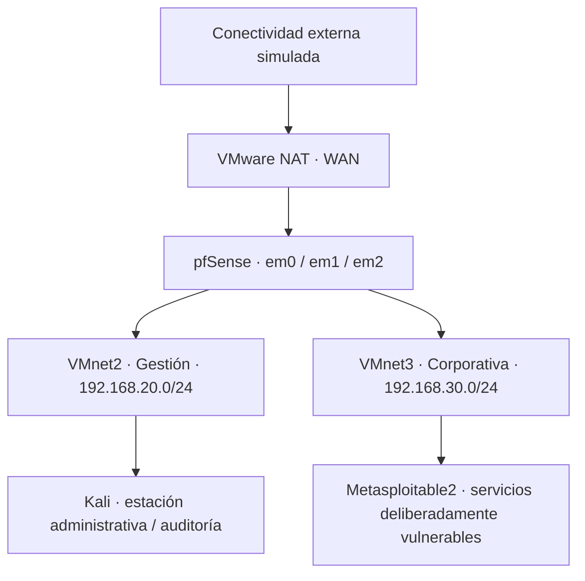

# pfSense · Laboratorio de defensa en profundidad

**Segmentación de red, protección del gateway y cifrado de comunicaciones en un entorno virtualizado.**

Miniproyecto documental derivado del TB1 de **Fundamentos en Ciberseguridad — UPC, Grupo 2**. Su objetivo es comunicar el problema, las decisiones defensivas, la evidencia antes/después y los riesgos que permanecen. No es una imagen de las máquinas ni una configuración lista para producción.

> **Fuente vigente:** informe corregido aportado por el usuario; sustituye la selección anterior. Véase [historial de correcciones](CHANGELOG.md).

> **Estado:** laboratorio académico documentado. Las pruebas pertenecen al trabajo original; no se volvieron a ejecutar al preparar este repositorio. No contiene discos virtuales, credenciales ni respaldos de configuración completos.

## Resumen ejecutivo

El laboratorio conectó una zona de gestión y una zona corporativa mediante pfSense. El escenario inicial permitía el acceso de un equipo no registrado y exponía comunicaciones Telnet/HTTP a interceptación. Se combinaron restricciones DHCP/Static ARP, filtrado de servicios por origen, autenticación SSH por clave, cifrado web y bloqueo local de intentos de autenticación.

La evidencia respalda una reducción del riesgo **en los escenarios evaluados**. No demuestra inmunidad de la LAN a ARP spoofing, eliminación de vulnerabilidades de Metasploitable2/DVWA ni seguridad criptográfica apta para producción.

## Arquitectura declarada



**Alcance actualizado:** pfSense, Kali y Metasploitable2. El diagrama corregido utiliza `.50` para los hosts autorizados; los anexos conservan `.2` y algunas capturas `.100`. Estas diferencias se documentan en [Arquitectura](docs/arquitectura.md), sin atribuir a Windows pruebas que no forman parte del desarrollo corregido.

## Controles y resultados

| Control | Evidencia conservada | Límite principal |
|---|---|---|
| DHCP para clientes conocidos y Static ARP | Configuración, tabla del gateway y fallo de conectividad observado | Causa del fallo no concluyente; no protege toda la LAN; MAC spoofing pendiente |
| Filtrado de Telnet y restricción SSH por origen | Bloqueo Telnet desde `.30`, permiso desde `.100`; reglas y registros SSH | No acredita deshabilitación total de Telnet ni sustituye autenticación |
| SSH por clave | Configuración y acceso exitoso con clave explícita | Servidor legado y excepciones de compatibilidad |
| HTTPS | Captura con negociación TLS y carga cifrada | TLS 1.0: demostración histórica, no perfil de producción |
| fail2ban | Parámetros y registro de bloqueo | Bloqueo reactivo; 30 segundos usados para prueba |

## Recorrido del proyecto

1. [Informe técnico](docs/informe-tecnico.md): objetivos, amenazas, implementación, resultados y conclusiones.
2. [Arquitectura y direccionamiento](docs/arquitectura.md): zonas, activos y discrepancias documentales.
3. [Evidencias](docs/evidencias.md): capturas seleccionadas, origen y alcance de cada afirmación.
4. [Riesgo residual y mejoras](docs/riesgo-residual.md): lo mitigado, lo pendiente y limitaciones del laboratorio.
5. [Procedencia y referencias](docs/fuentes.md): fuentes utilizadas y criterios editoriales.
6. [Seguridad del repositorio](SECURITY.md): exclusiones y protección de información sensible.

## Estructura

```text
.
├── README.md
├── SECURITY.md
├── .gitignore
├── docs/
│   ├── informe-tecnico.md
│   ├── arquitectura.md
│   ├── evidencias.md
│   ├── riesgo-residual.md
│   └── fuentes.md
├── assets/evidencias/          Capturas seleccionadas del informe
└── metadata/
    ├── fuentes.json           Huellas de documentos utilizados
    └── evidencias.json        Correspondencia imagen–fuente y huellas
```

## Competencias demostradas por el trabajo

- Diseño y documentación de zonas de red en un laboratorio virtual.
- Relación amenaza → control → prueba → riesgo residual.
- Inspección de tablas ARP y captura de tráfico.
- Filtrado de servicios y autenticación por claves.
- Interpretación de registros de firewall y de autenticación.
- Comunicación de resultados con límites explícitos.

## Alcance ético y operativo

Las pruebas se realizaron sobre un entorno académico propio. No se incluyen instrucciones para atacar terceros ni listas de contraseñas. Metasploitable2 y DVWA deben mantenerse aislados; este repositorio no despliega ni ejecuta servicios.

**Conservar este informe no conserva las máquinas.** No permite recuperar automáticamente archivos internos, instantáneas, estado de ejecución o la configuración exacta de pfSense. Los originales permanecen fuera del repositorio.

## Autoría

Trabajo académico original del **Grupo 2**, curso Fundamentos en Ciberseguridad de la UPC. Organización editorial del repositorio asistida por Hermes, sin atribuir aportes individuales no documentados. Se omiten nombres completos, códigos universitarios y otros datos personales; la autoría detallada se conserva en el informe original local.
