# Evidencias del laboratorio

[Inicio](../README.md) · [Informe](informe-tecnico.md)

## Procedencia y lectura

Las capturas proceden del DOCX principal. Se conservaron 15 de sus 42 imágenes únicas, seleccionadas por pertinencia y ausencia de credenciales visibles. Se sustituyó el diagrama por el de la versión corregida; las otras 14 capturas coinciden por SHA-256 con archivos de esa versión. Se excluyen capturas con secretos, material redundante y pasos intermedios no necesarios para este miniproyecto. Los originales permanecen localmente.

Las imágenes se exportaron como PNG sin los metadatos originales. No se alteraron resultados ni se generaron pantallas de pruebas. La correspondencia y huellas están en [evidencias.json](../metadata/evidencias.json).

**Estas son evidencias históricas del trabajo, no resultados de una ejecución nueva.** La falta de evidencia no se rellena con conclusiones supuestas.

## E-01 · Arquitectura declarada

Diagrama del informe corregido: pfSense, Kali administrativa `.20.50`, Kali no autorizada `.20.3` y Metasploitable2 `.30.50`. No incluye Windows. Se conserva como diseño declarado, no como certificación del estado de ejecución.

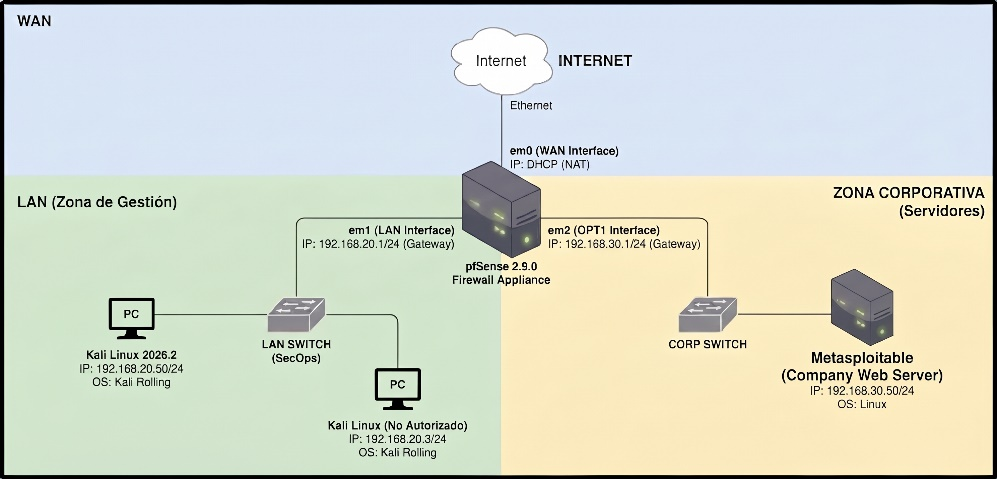

Origen: imagen 2 del documento corregido.

## E-02 · Conectividad inicial

Respuestas de ping hacia gateway y objetivo. Solo demuestra conectividad a los destinos mostrados.

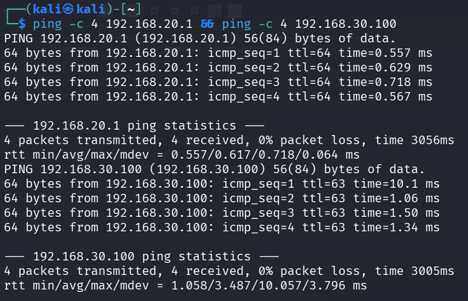

Origen: imagen 3 del documento corregido.

## E-03 · Tabla ARP del cliente

Asociaciones observadas durante el escenario inicial. La repetición de una MAC en varias IP requiere contexto; no identifica por sí sola a una persona.

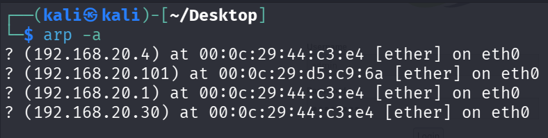

Origen: imagen 4 del documento corregido.

## E-04 · Configuración Static ARP

Opción habilitada y dos mapeos visibles (.100 y .101). La narrativa menciona un único cliente en otra fase; esta diferencia se mantiene explícita.

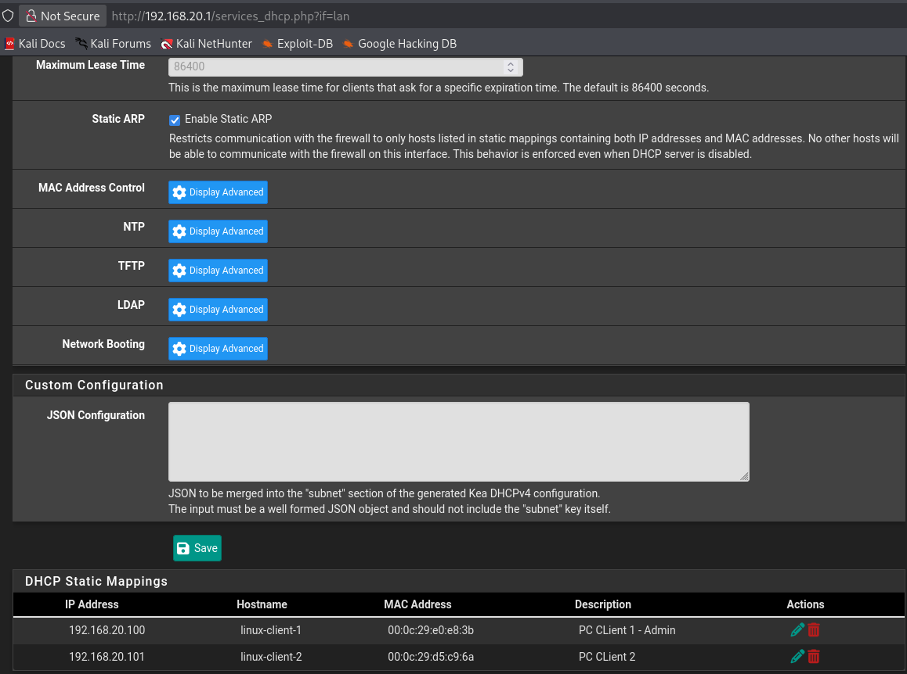

Origen: imagen 5 del documento corregido.

## E-05 · Tabla ARP del gateway

Captura de pfSense incluida como estado posterior. No sustituye una prueba de protección de todos los clientes LAN.

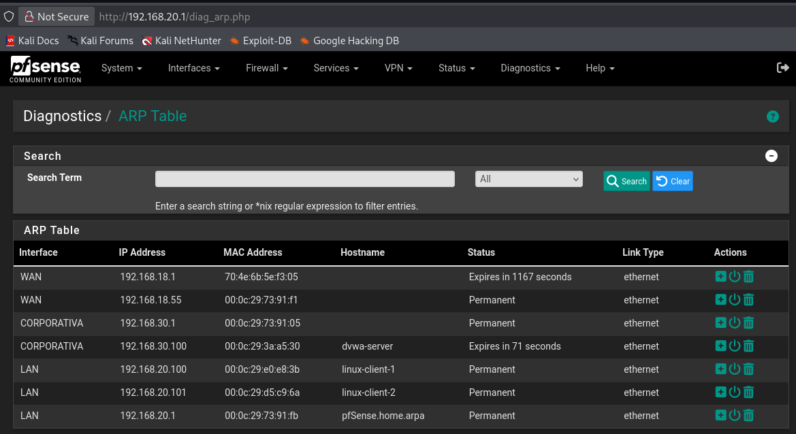

Origen: imagen 7 del documento corregido.

## E-06 · Intento de conectividad posterior

La salida indica Network is unreachable. No prueba por sí sola descarte de paquetes por el firewall: es necesario comprobar rutas y estado de interfaz.

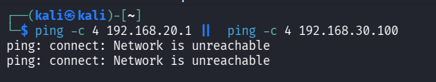

Origen: imagen 8 del documento corregido.

## E-07 · Registros de filtrado Telnet

Bloqueos al puerto 23 desde .30 y acceso permitido desde .100. Evidencia filtrado diferenciado, no bloqueo global de Telnet.

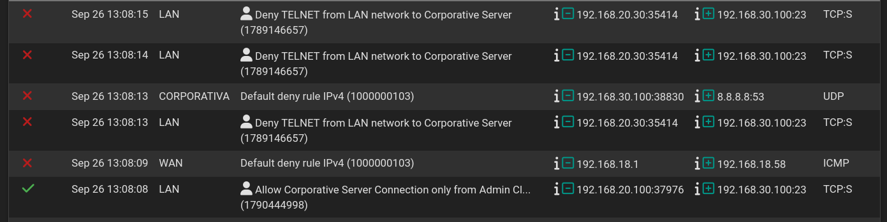

Origen: imagen 11 del documento corregido.

## E-08 · Acceso SSH con clave

Comando con clave explícita y sesión exitosa sin solicitud de contraseña visible. Contiene opciones de compatibilidad legacy y no demuestra que todos los métodos alternativos estén deshabilitados.

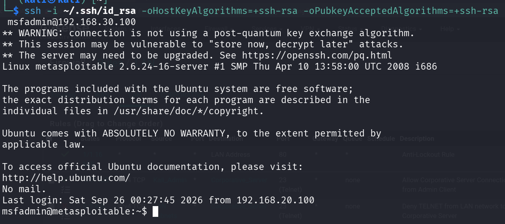

Origen: imagen 12 del documento corregido.

## E-09 · Intento SSH rechazado

Connection refused en un intento documentado. Interpretar junto con reglas y registros, no como diagnóstico aislado de la causa.

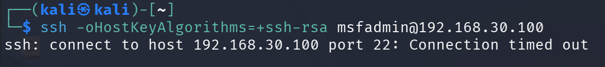

Origen: imagen 13 del documento corregido.

## E-10 · Flujo SSH capturado

Banner/negociación visibles y carga posterior no legible como credenciales en claro. No oculta todos los metadatos.

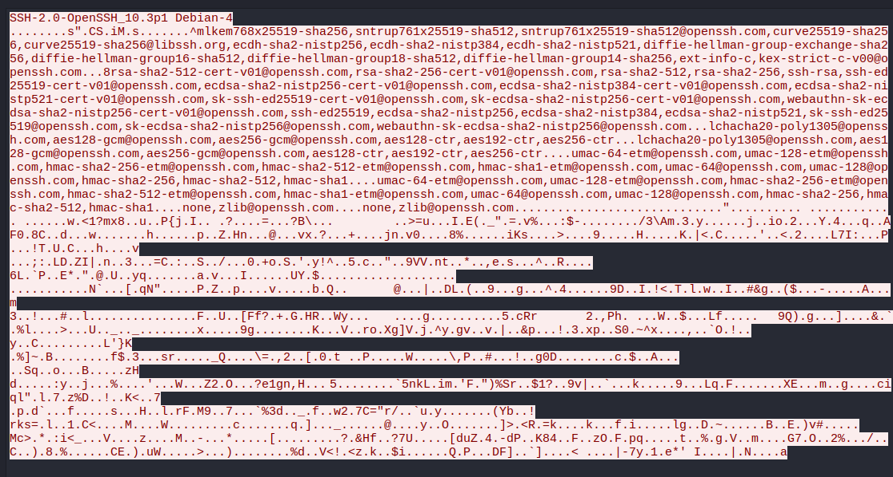

Origen: imagen 14 del documento corregido.

## E-11 · Registro de fail2ban

Eventos de fallos de autenticación y acciones Ban/Unban. El log reúne momentos de prueba distintos; no se deduce una duración uniforme de todos los bloqueos.

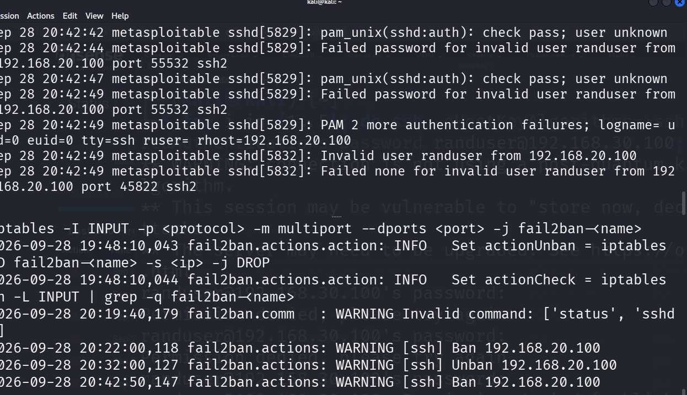

Origen: imagen 15 del documento corregido.

## E-12 · Captura TLS del laboratorio

Negociación TLSv1 y datos cifrados. TLS 1.0 es una limitación legacy, no una configuración apta para producción ni prueba de validación de certificado.

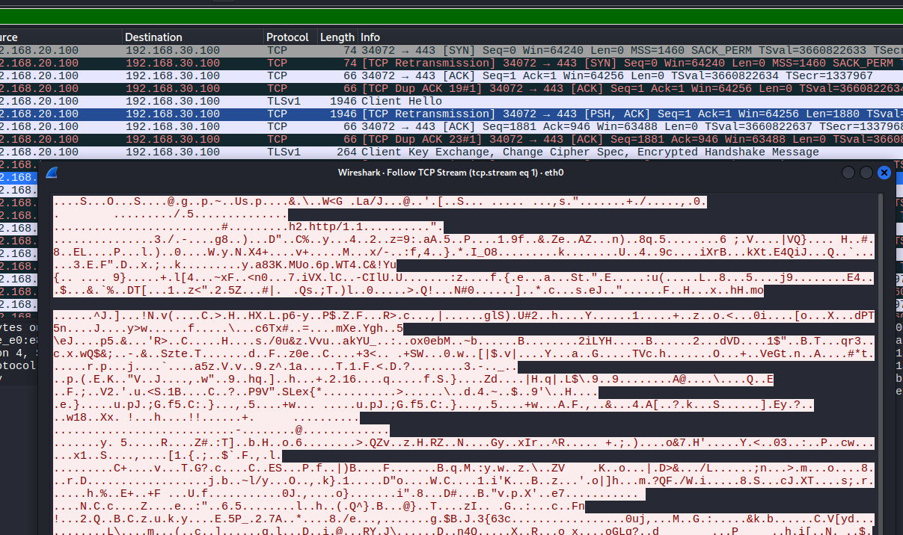

Origen: imagen 16 del documento corregido.

## E-13 · Parámetros SSH declarados

Salida de configuración: root deshabilitado, claves habilitadas y contraseñas deshabilitadas. Requiere validar estado efectivo y pruebas negativas adicionales.

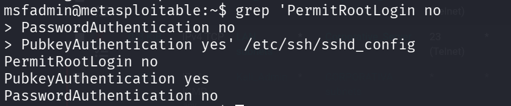

Origen: imagen 34 del documento corregido.

## E-14 · Reglas SSH por origen

Regla de permiso administrativa y regla de bloqueo posterior. Nombres de alias no equivalen a un inventario completo de direcciones.

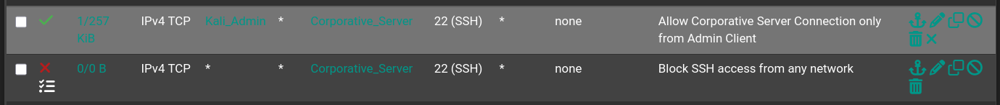

Origen: imagen 37 del documento corregido.

## E-15 · Parámetros fail2ban de prueba

maxretry=3 y bantime=30. Valores para el ejercicio; no se presentan como política universal. El nombre del jail mostrado difiere del nombre en otra captura de logs.

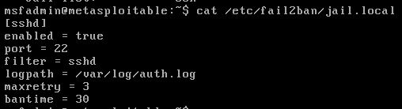

Origen: imagen 39 del documento corregido.

## Material no publicado

Se omitieron las capturas Telnet/HTTP con credenciales en claro, pantallas de autenticación innecesarias, resultados sensibles de pruebas de contraseñas y pantallas de preparación redundantes. Su exclusión impide usar este repo para recuperar secretos del laboratorio.

Windows/RDP/auditoría no forma parte del desarrollo técnico de la versión corregida. La fila Windows que permanece en el anexo 2 no se utiliza como evidencia de ejecución.

La evidencia de conectividad posterior y el log Telnet tienen límites señalados: error de ruta y excepción de acceso, respectivamente. No se interpretan como aislamiento universal ni eliminación total de protocolos inseguros.
